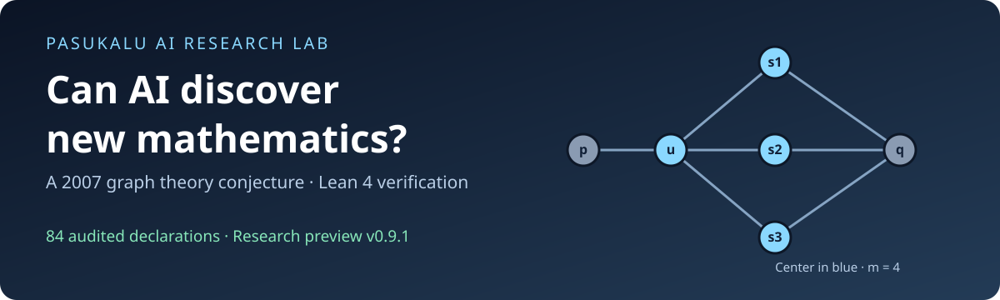

# AI 能发现新的数学知识吗？

[English](README.md) · [研究预览 v0.9.1](https://github.com/Pasukalu/center-domination-spectrum/releases/tag/v0.9.1) · [论文 PDF](https://github.com/Pasukalu/center-domination-spectrum/releases/download/v0.9.1/main.pdf)

Pasukalu AI Research Lab 的公开科研实验：围绕 2007 年提出的图论猜想进行数学研究，使用 Lean 4 验证核心声明，并公开证明、实验和审查材料。

## 研究结果与验证边界

- 第 268 号猜想对应的严格平均中心距离不等式已形式化验证。
- 全支配数为 2 时的完整中心距离谱、极值树条件、指定支配边的 0/2/4 最小扩张分类和适用的最小阶数界已验证。
- 第 269 号猜想只获得部分结果；更强的纸面生成树引理未单独形式化。
- CI #155 完成 1,187 项构建任务、84 项声明公理依赖审计及独立内核重放。[实际 CI](https://github.com/Pasukalu/center-domination-spectrum/actions/runs/45878211836)。
- 84 项声明不等于 84 个原创定理。既有理论已注明出处，原创性与独立人类专家审查尚未完成。

## 互动探索器

[网站源码](docs/) 支持中心距离谱构造、自定义图边编辑、半径与直径、全支配数、精确分数和四环检测。使用 `python -m http.server 8000 --directory docs` 启动本地静态服务器，再访问 `http://localhost:8000`。无需第三方前端库或网络接口。GitHub Pages 的公开部署需要启用 Actions 发布源。

## 参与审查

欢迎提供反例、文献线索和形式化定义问题：[专家审查包](verification/expert-review-packet.md)、[原创性审查报告](verification/phase4-priority-review-2026-11-27.md)、[期刊及 AI 政策](research/journal-and-ai-policy-review.md)、[提交问题](https://github.com/Pasukalu/center-domination-spectrum/issues/new)。

完整数学陈述、复现命令与形式化覆盖范围以 [英文 README](README.md) 为准。本项目为 AI 生成的研究预览，不是同行评审论文，不保证首创性、作者资格或发表结果。